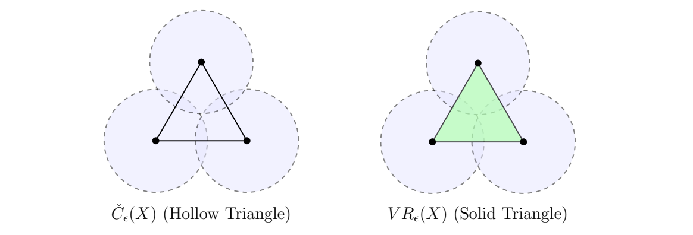

> [!lem] [Lemma 02 (Čech and Vietoris-Rips Interleaving)](Lemma%2002%20%28%C4%8Cech%20and%20Vietoris-Rips%20Interleaving%29.md): For a finite point cloud $X\subseteq\mathbb{R}^{n}$ and $\epsilon>0$,
>
> $$
> \check{C}_{\epsilon}(X)\subseteq\operatorname{VR}_{\epsilon}(X)\subseteq\check{C}_{\sqrt{2}\epsilon}(X).
> $$
>

> [!rem] The sharper Euclidean inclusion is $\operatorname{VR}_{\epsilon}(X)\subseteq\check{C}_{\epsilon\sqrt{2n/(n+1)}}(X)$; its planar constant is $2/\sqrt{3}$, while $\sqrt{2}$ works in every dimension. In a general metric space, choosing a vertex as center gives only $\operatorname{VR}_{\epsilon}(X)\subseteq\check{C}_{2\epsilon}(X)$. This interleaving relates persistent topological features in Vietoris-Rips and Čech complexes, supporting the widespread computational use of Vietoris-Rips.

###### Examples.
> [!eg] Ex. 1: 

> [!eg] Ex. 2: For the unit-square corners $(0,0),(1,0),(1,1),(0,1)$, side lengths are $1$ and diagonal lengths $\sqrt{2}$. Every triple is a right triangle with smallest enclosing radius $\sqrt{2}/2$; the same ball, centered at $(1/2,1/2)$, encloses all four. For $0<\epsilon<1/2$, both complexes are four isolated points. For $1/2\leq\epsilon<\sqrt{2}/2$, both are a hollow square, homeomorphic to $S^1$. For $\epsilon\geq\sqrt{2}/2$, both are a full contractible $3$-simplex. The union of disks has a central hole exactly in the middle range. The loop is born at $1/2$ and dies at $\sqrt{2}/2$; recording such births and deaths across scales is persistent homology (Weeks 7–8).

> [!eg] Ex. 3: For an equilateral triangle of side $s$, the circumradius is $s/\sqrt{3}$. The Čech complex is a hollow triangle for $s/2\leq\epsilon<s/\sqrt{3}$, whereas the Vietoris-Rips complex is filled for every $\epsilon\geq s/2$. The Čech loop is born at $s/2$ and dies at $s/\sqrt{3}\approx0.577s$; Vietoris-Rips misses it. Since $s/\sqrt{3}=(2/\sqrt{3})(s/2)$, the planar interleaving constant is attained.

> [!eg] Ex. 4: Worksheet result: {unresolved}; see [Exercise 05 (Equilateral Triangle Complexes)](Exercises/Exercise%2005%20%28Equilateral%20Triangle%20Complexes%29.md).

###### Proof.
> [!pf] *Proof.* If $\sigma\in\check{C}_{\epsilon}(X)$, choose $z$ with $d(x_i,z)\leq\epsilon$ for all $x_i\in\sigma$. The triangle inequality gives $d(x_i,x_j)\leq2\epsilon$, so $\sigma\in\operatorname{VR}_{\epsilon}(X)$. Conversely, a Vietoris-Rips simplex has diameter $D\leq2\epsilon$. Jung’s theorem places a Euclidean set of diameter $D$ in a closed ball of radius $D\sqrt{n/(2(n+1))}$. Thus $\sigma$ is contained in a ball of radius
>
> $$
> 2\epsilon\sqrt{\frac{n}{2(n+1)}}=\epsilon\sqrt{\frac{2n}{n+1}}\leq\sqrt{2}\epsilon.
> $$
>
> The center belongs to every $\overline{B}_{\sqrt{2}\epsilon}(x_i)$, so $\sigma\in\check{C}_{\sqrt{2}\epsilon}(X)$. $\blacksquare$

###### Dependencies.
- [Definition 31 (Čech Complex)](Definition%2031%20%28%C4%8Cech%20Complex%29.md)
- [Definition 32 (Vietoris-Rips Complex)](Definition%2032%20%28Vietoris-Rips%20Complex%29.md)
- [Definition 0-1 (Metric Space)](Definition%200-1%20(Metric%20Space).md)
- Jung Theorem {unresolved}

###### References.
[1] Pamuk (2026 Fall) *Lecture*.

[2] Pamuk, M. (2026). *[MATH423: Introduction to Computational Topology: Lecture Notes](_materials/Pamuk-3.pdf)* (pp. 7 (7), 8 (8)).

#mathematics #computational-topology #lemma
