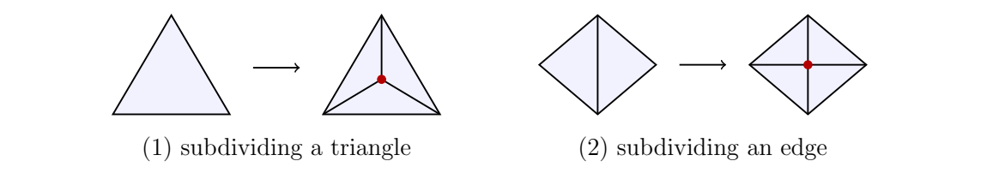

> [!thm] [Theorem 05 (Euler Characteristic Is Invariant)](Theorem%2005%20%28Euler%20Characteristic%20Is%20Invariant%29.md): The Euler characteristic is a topological invariant and is independent of the chosen triangulation.

###### Motivation.
The separate counts $V,E,F$ change under refinement. In the *alternating sum*, their changes cancel.

###### Examples.
> [!eg] Ex. 1: 

> [!eg] Ex. 2: Subdivide the tetrahedron edges $\{1,2\}$ and then $\{3,4\}$. The six resulting vertices each have degree $4$, giving an octahedron. The Euler characteristic remains $2$ at each step.

###### Proof.
> [!pf] *Proof.* For a closed triangulated surface, insert a vertex inside a triangle and join it to its three corners: one triangle becomes three, so $(\Delta V,\Delta E,\Delta F)=(1,3,2)$. Alternatively, insert a vertex inside an edge and join it to the opposite corners of its two incident triangles: the split edge and two additional edges again give $(1,3,2)$, while two triangles become four. Both moves change $\chi$ by $1-3+2=0$. A classical theorem due to Radó, Alexander and Newman connects any two triangulations of a closed surface by finitely many of these moves and their inverses. Therefore $\chi$ is independent of the triangulation. The source postpones the proof in every dimension to Week 5, using the alternating sum of homology ranks. $\blacksquare$

###### Dependencies.
- [Definition 26 (Euler Characteristic)](Definition%2026%20%28Euler%20Characteristic%29.md)
- [Lemma 01 (Closed Surface Edge Incidence)](Lemma%2001%20%28Closed%20Surface%20Edge%20Incidence%29.md)
- Triangulation Refinement Theorem {unresolved}
- Homology Euler Formula {unresolved}

###### References.
[1] Pamuk (2026 Fall) *Lecture*.

[2] Pamuk, M. (2026). *[Triangulations, Classification of Surfaces and Abstract Simplicial Complexes](_materials/Pamuk-2.pdf)* (pp. 3 (3), 4 (4)).

#mathematics #computational-topology #theorem
