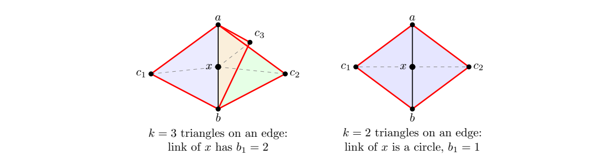

> [!thm] [Theorem 15 (Local Homology from Links)](Theorem%2015%20%28Local%20Homology%20from%20Links%29.md): For $x\in\lvert K\rvert$, subdivide if necessary to make $x$ a vertex. The homology of $\operatorname{lk}(x)$ is independent of the subdivision and is determined by a neighborhood of $x$ up to homeomorphism. In the shifted local homology description, use reduced homology of the link.

> [!rem] The lecture states this without proof. The reference links are a circle at an interior point of a surface, a path at a boundary point, and an $(n-1)$-sphere at an interior point of an $n$-ball. A vertex whose link has Betti tuple neither $(1,1)$ nor $(1,0)$ cannot have an open disk or half-disk neighborhood. Computing a vertex link is on Midterm 1; using local homology to detect a surface is outside it.

###### Examples.
> [!eg] Ex. 1: Subdivide an edge $\{a,b\}$ at $x$ when it belongs to $k\geq1$ triangles $\{a,b,c_i\}$. The link is the connected graph with $k+2$ vertices $a,b,c_1,\ldots,c_k$ and $2k$ edges $\{a,c_i\},\{b,c_i\}$. By [Proposition 06 (Betti Numbers of Graphs)](Proposition%2006%20%28Betti%20Numbers%20of%20Graphs%29.md), $b_1=k-1$. Thus a disk neighborhood requires $k=2$ and a half-disk neighborhood requires $k=1$.
>
> 

> [!eg] Ex. 2: The bowtie consists of $\{0,1,2\}$ and $\{0,3,4\}$ and their faces. The triangles are cones and meet at one vertex, so the union has the homology of a point by [Proposition 07 (Betti Numbers of One-Point Unions)](Proposition%2007%20%28Betti%20Numbers%20of%20One-Point%20Unions%29.md) and [Proposition 08 (Homology of a Cone)](Proposition%2008%20%28Homology%20of%20a%20Cone%29.md). But the link of $0$ is the two disjoint edges $\{1,2\}$ and $\{3,4\}$ with their vertices, giving $b=(2,0)$. Thus $0$ is a pinch point; ordinary homology of the entire complex does not distinguish it from a disk.
>
> 

> [!eg] Ex. 3: The tuple is $(1,0,1)$; the link has $(2,1)$ and the polyhedron is not a surface (see [Exercise 96 (Tetrahedron Boundary with an Edge)](Exercises/Exercise%2096%20%28Tetrahedron%20Boundary%20with%20an%20Edge%29.md)).

###### Dependencies.
- [Definition 29 (Skeletons Stars and Links)](Definition%2029%20%28Skeletons%20Stars%20and%20Links%29.md)
- [Definition 36 (Simplicial Homology)](Definition%2036%20%28Simplicial%20Homology%29.md)
- [Theorem 13 (Homotopy Invariance of Homology)](Theorem%2013%20%28Homotopy%20Invariance%20of%20Homology%29.md)
- Local Homology {unresolved}

###### References.
[1] Pamuk (2026 Fall) *Lecture*.

[2] Pamuk, M. (2026). *[Lecture notes on simplicial homology](_materials/Pamuk-4.pdf)* (pp. 17 (17), 18 (18), 20 (20)).

#mathematics #computational-topology #theorem
